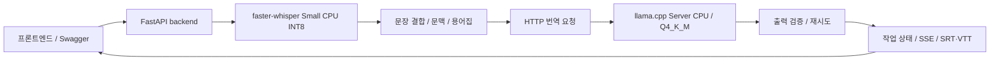

# K-aption BE 개발·운영 안내

## 실행 구조

모든 플랫폼은 Qwen3-4B-Instruct-2507 GGUF Q4_K_M을 llama.cpp Server CPU에서 실행합니다.
backend는 번역 가중치를 직접 로드하지 않습니다. Ollama·MLX·CUDA·Metal 런타임은 사용하지 않습니다.



`model-init`은 최초 준비·캐시 SHA256 검증 후 종료합니다. backend는 translator health 통과 뒤 시작합니다.
모델·Whisper 캐시·작업 결과는 각각 `qwen-model`, `whisper-cache`, `jobs` 볼륨에 보존합니다.
translator는 internal 네트워크만 사용하고 호스트 포트를 공개하지 않습니다. backend만 localhost:8000을 공개합니다.
Dockerfile은 플랫폼을 강제하지 않습니다. 공식 CPU 이미지의 고정 OCI 인덱스에서 amd64·arm64 바이너리를 선택하고 backend Python 의존성도 해당 플랫폼에서 설치합니다.
x86 AVX2/F16C/FMA 빌드 옵션을 ARM64에 강제로 적용하지 않습니다.

## Windows와 Mac 실행

Docker Desktop을 켜고 프로젝트 폴더에서 아래 명령을 사용합니다. Windows는 WSL2 Linux 컨테이너를 선택합니다.

```bash
docker compose up -d --build
docker compose ps
docker compose logs -f backend translator model-init
docker compose down
```

`docker compose up -d`는 이미지를 재빌드하지 않고 저장된 모델을 재사용합니다.
코드를 바꿨으면 `--build`를 붙입니다. 모델 검증만 다시 하려면 `docker compose run --rm model-init`을 실행합니다.
`make up`, `make down`, `make logs`, `make model`도 같은 작업을 실행합니다.
작업 도구와 CI에서는 비밀값 없는 `docker/cpu.defaults`를 `--env-file`로 지정해 프로젝트 `.env` 자동 읽기를 피합니다.

최초 모델 다운로드는 공개 HTTPS 배포만 사용하며 토큰·API 키가 필요하지 않습니다.
고정 명세는 `docker/qwen3-model.json`이고, 임시 파일 스트리밍·파일 크기·개별 및 전체 SHA256·배타 잠금·원자적 교체를 적용합니다.
기존 파일이 손상됐으면 자동 덮어쓰기하지 않고 실패합니다. `model-init` 로그를 확인해 손상 파일을 별도 백업한 뒤 다시 준비합니다.
전체 볼륨 삭제는 모델과 결과를 지우므로 복구의 기본 절차로 사용하지 않습니다.

## 모델과 CPU 설정

Q4_K_M 파일은 약 2.50GB이며 Q8_0 약 4.28GB보다 작습니다. Windows 16GB 장비에서 모델과 STT를 함께 운영할 메모리 여유를 확보하기 위해 변경했습니다.
원본 Qwen 모델 버전은 유지합니다. 양자화에 따른 번역 변화는 실제 비교 기록을 확인합니다.
모델 파일은 이미지에 포함하지 않습니다. 출처·라이선스는 `third_party/qwen3/NOTICE.md`와 `LICENSE`에 있고 model-init이 모델 볼륨에 복사합니다.
과거 Q8_0 명세는 비교용 `evaluation/qwen3-q8-model.json`, MLX 출처·은퇴한 테스트 입력은 `evaluation/archive/`에 보존합니다.

서버는 device none·GPU layers 0·KV/연산 오프로딩 비활성화·context 2048·parallel 1·cache RAM 0을 사용합니다.
메모리 매핑은 llama.cpp 기본 동작을 사용하고 메모리 잠금은 사용하지 않습니다.
`--no-repack`으로 CPU 가중치 재배치를 비활성화해 가중치를 회수 가능한 파일 매핑으로 유지합니다. 약 4.11GB ARM64 Docker VM의 5분 시험에서 기본 재배치는 OOM을 일으켰으며, 비활성화한 비교는 OOM·재시작 없이 끝났지만 번역 4구간이 실패했습니다. CPU 커널·파일 재접근에 따라 속도와 수치 결과가 달라질 수 있어 x86 성능 향상으로 해석하지 않습니다.
backend는 서버의 실제 채팅 템플릿과 토크나이저로 입력+출력 2048토큰 상한을 검사합니다.
참고 영어 문맥은 지시어·대명사·앞 연산을 이어가는 단서가 있는 발언에만 전달하며 마지막 256자로 제한합니다. 명시적인 독립 문장은 문맥을 생략하고 정정·대조 발언은 유지합니다. 이는 문자열 휴리스틱으로 모든 문장의 문맥 의존성을 판별하지는 못합니다. 생성은 temperature 0·top_k 1·top_p 1·repeat_penalty 1·seed 0입니다.

| 환경변수 | 기본값 | 의미 |
| --- | --- | --- |
| KAPTION_CPU_THREADS | 4 | translator 생성·프롬프트 평가 스레드 |
| KAPTION_TRANSLATOR_CPUS | 4 | translator CPU 코어 한도 |
| KAPTION_BACKEND_CPUS | 4 | backend CPU 코어 한도 |
| KAPTION_STT_THREADS | 4 | backend OpenMP 스레드 |
| KAPTION_TRANSLATOR_TIMEOUT | 120 | 번역 서버 HTTP 읽기·쓰기 제한 초, 연결은 최대 10초 |
| KAPTION_TRANSLATOR_PROMPT_CACHE | true | 같은 슬롯의 공통 프롬프트 KV 재사용. false로 비활성화 가능 |
| KAPTION_PORT | 8000 | localhost backend 공개 포트 |
| KAPTION_TRANSLATOR_URL | http://translator:8080 | backend 내부 서버 주소. Compose에서 고정 |
| KAPTION_MAX_ACTIVE_JOBS | 2 | 업로드·대기·실행을 합친 미완료 작업 한도 |
| KAPTION_JOB_TTL_SECONDS | 86400 | 완료 작업 보관 초 |

Compose 외부의 개발 backend는 기본 translator 주소가 http://localhost:8080입니다. CPU 서버가 먼저 실행돼 있어야 합니다.

```bash
make setup-api
make api
```

과거 `KAPTION_TRANSLATION_BACKEND`, `KAPTION_TRANSLATION_MODEL`, `KAPTION_TRANSLATION_DEVICE`, MLX 모델 경로·변환 명령은 사용하지 않습니다.
Qwen 모델·Q4 파일·CPU 실행은 기본 배포에서 고정되며 환경변수로 과거 엔진을 선택하지 않습니다.

## 문맥·검증·작업 처리

기본 물리 용어집 28개와 Qwen 추가 용어 8개를 프롬프트에 사용합니다. 기본 용어와 rocket·sled는 지정 번역 포함 여부도 검사합니다.
존댓말 지시·원문 문맥 분리·문장 및 수식 연결 결합·한글 형식·문맥 복사·반복·숫자·변수·영어 연산어 검증을 유지합니다.
기본 문장 묶음은 18초·350자 안에서 구성합니다. `is a / constant`, `our initial / velocity`처럼 상한에서 끊긴 명확한 미완성 수학 발언은 후속 단계에서 최대 36초·350자 안에서 연결합니다. 종결 문장·다음 질문·2초 초과 무음은 연결하지 않으며, 입력 원문과 첫 시작·마지막 종료 시각을 유지합니다. 따라서 일부 자막 구간이 이전보다 길어질 수 있습니다.
수식 보호 대상에서 제외한 발언은 기존처럼 지원 기호의 `m of vR`·`dmR over mR`에 대해 프롬프트에서 함수·분수 표기도 안내합니다. 검증기는 함수 이름·인수와 분수의 항·방향을 확인하며, `m(vR)`·슬래시·LaTeX 분수·`분의`·분모를 앞이나 뒤에 둔 한국어 나누기 표현을 허용합니다. 일반 수식 해석기나 STT 오류 복원기는 아니며 불명확한 로그의 분자·적분 결과를 추론하지 않습니다. 이 검사를 통과해도 전체 수식 의미의 정확성을 보장하지 않습니다. [수식 회귀 확인](evaluation/rocket-math-regression-261025.md)을 참고하세요.

번역 입력 준비 단계에서는 발언에 있는 수식을 모두 표현할 수 있는 명확한 단순 함수·분수·원자 등식만 `[MATH_A]` 같은 표식으로 보호합니다. 보호 뒤 다른 지원 기호·영어 연산어가 남으면 발언 전체를 기존 번역 처리에 남깁니다. 복합 설명의 일부 수식만 가리면 다른 항과의 관계가 끊길 수 있기 때문입니다. 예를 들어 `mR prime equals m of vR`는 복원 시 `mR′ = m(vR)`로 표기합니다. 모델이 표식을 한 번씩 같은 순서로 보존했는지 확인하고 복원한 뒤, **보호 전 원문**을 기준으로 기존 숫자·변수·용어·관계·존댓말 검증을 모두 수행합니다. 표식의 누락·변경·중복·순서 역전은 `math_placeholder_mismatch`로 재시도하고, 최종 실패의 API 형식은 기존 `translation_failed`입니다. 원문에 예약 표식이 있으면 충돌을 피하기 위해 수식 보호를 생략합니다. API의 영어 원문·시각은 바꾸지 않습니다.

연쇄 연산·괄호식·중단된 등식은 전체 식으로 확정하지 않습니다. `dvR equals u is a constant`를 완성된 등식으로 보호하지 않고, 로그나 적분 범위·불명확한 `u1`을 추론하지 않습니다. 수식 보호는 일반적인 수학 파서나 정확도 보증 기능이 아닙니다. 기존 시스템·사용자 번역 지시는 유지합니다. 지시를 줄인 후보는 문장 품질이 나빠져 채택하지 않았습니다. STT 설정·모델·CPU 제한·시도 상한·출력 토큰 한도는 이 변경으로 바뀌지 않습니다.

[수식 보호·문맥 선택 검증](evaluation/translation-inputs-analysis-261025.md)에 전체 영상·선택 입력 교차 비교와 기각 후보를 보존했습니다. 선택 입력에서는 시간·실패가 감소했지만 전체 영상의 속도 개선은 검증되지 않았습니다.
검증 실패나 서버 장애는 최대 2회 시도하며 재시도에서는 이전 문맥을 제거합니다. 토큰 상한 종료·빈 응답·불완전 SSE 종료를 성공으로 처리하지 않습니다.
STT 추론과 번역은 공유 잠금으로 동시 실행을 막고 작업자는 하나입니다. 오디오 디코딩과 모델 준비는 추론 잠금 바깥에 있어 메모리 경쟁이 완전히 사라지는 것은 아닙니다.
Whisper는 지연 로드하고 재사용합니다. Qwen은 translator에서 한 번 로드돼 STT 중에도 메모리를 차지합니다.
긴 음성의 FFT 임시 배열이 backend 한도를 넘지 않도록 log-Mel 특징 계산을 최대 3000프레임씩 수행합니다. 입력 음성·VAD·전사 문맥은 나누지 않고, 패딩·프레임·Mel 필터와 전체 음성 최대값 정규화를 유지합니다. 기존 추출기와 수치 비교한 허용 오차는 `rtol=1e-5`, `atol=1e-6`입니다. 최종 특징과 디코딩 오디오는 길이에 비례하므로 모든 길이의 메모리가 고정되는 것은 아닙니다.
단일 backend 프로세스·Uvicorn worker 1을 유지해야 합니다. 같은 작업 저장소를 여러 worker가 공유하면 시작을 거부합니다.

## API 계약

Swagger는 `/swagger`, OpenAPI는 `/openapi.json`입니다.

| API | 용도 |
| --- | --- |
| GET /health | 원격 번역 준비·STT 로딩 여부 |
| GET /api/v1/capabilities | 확장자·업로드 크기·길이·언어 제한 |
| POST /api/v1/translations | 영어 원문·문맥 번역 |
| POST /api/v1/transcriptions | 동기 파일 처리 |
| POST /api/v1/jobs | 파일 작업 접수 |
| GET /api/v1/jobs/{job_id} | 진행 상태 |
| GET /api/v1/jobs/{job_id}/events | SSE 상태·heartbeat |
| POST /api/v1/jobs/{job_id}/cancel | 취소 요청 |
| GET /api/v1/jobs/{job_id}/result | 최종 구간 JSON |
| GET /api/v1/jobs/{job_id}/subtitles | SRT/VTT 다운로드 |

입력은 영어이며 MP4·MOV·MKV·WEBM·WAV·MP3·M4A, 최대 1GiB·90분입니다.
번역 검증 실패는 기존처럼 구간 `translation=null`, `translation_error=translation_failed`로 남고 다른 구간은 계속 처리합니다.
자막은 실패 구간에 영어를 사용합니다. 작업 취소는 진행 중 STT·현재 번역 호출이 끝나는 경계에서 처리합니다.
서버 health 실패는 `/health`의 준비 상태에 반영합니다. 컨테이너 재시작 시 진행 중 작업은 기존 복구 정책을 따릅니다.
용어·형식 검사 통과는 의미·전공 수식·맞춤법 정확도를 보장하지 않습니다.

## 요청 처리 시간 로그

기본 INFO 로그 설정에서 API 요청 시작은 `event=request_started`, 응답 전송 완료는 `event=http_request`로 기록됩니다. 같은 `request_id`로 해당 요청의 단계별 로그를 연결할 수 있습니다. 성공·HTTP 오류·예외·취소 모두 종료까지 관측한 시간이 남습니다.

```bash
docker compose logs -f backend
```

PowerShell에서 동기 파일 처리의 전체 시간만 보려면 다음과 같이 필터링합니다.

```powershell
docker compose logs -f backend | Select-String 'event=http_request.*path=/api/v1/transcriptions'
```

완료 로그 예시(실제 측정 결과가 아닌 형식 예시):

```text
event=http_request request_id=ab12cd34ef56 segment_index=None elapsed_seconds=814.565 method=POST path=/api/v1/transcriptions status_code=200 status=ok error_type=None elapsed_minutes=13.576
```

- `elapsed_seconds`: 서버의 요청 처리 시작부터 마지막 응답 조각 전송까지의 전체 소요 초입니다. 본문 업로드 수신·요청 검증·임시 파일 저장·STT·번역·재시도·정리·응답 직렬화 및 전송을 포함합니다. 클라이언트의 네트워크 왕복 시간과는 다릅니다.
- `elapsed_minutes`: 같은 전체 시간을 분으로 환산하고 소수 셋째 자리까지 반올림한 값입니다.
- `event=stt`: 해당 요청의 STT 전체 시간입니다. 첫 호출이면 STT 모델 로딩도 포함합니다.
- `event=translation_batch`: 문장 묶기 이후 전체 번역·검증·재시도 시간이며 `failed_segments`로 실패 구간 수를 확인합니다.

`/api/v1/transcriptions`는 STT 이후 번역까지 처리하므로 전체 시간을 STT 추론 시간으로 해석하지 않습니다. 일부 번역 실패가 있어도 HTTP 200이므로 `http_request status=ok`만으로 모든 구간 번역 성공을 판단하지 않습니다. 비동기 `/api/v1/jobs`의 HTTP 접수 시간은 작업 완료 시간이 아니며, 작업 처리 시간은 작업의 `elapsed_seconds`와 `event=job_processing` 로그로 확인합니다.

## 메모리 설정과 측정

초기 제한은 backend 2,500,000,000 bytes + translator 4,000,000,000 bytes입니다. 모델 준비 서비스는 256MiB 제한으로 모델 로딩 전에 종료합니다.
컨테이너 한도 합계 6.5GB와 호스트 Docker 관련 RAM 7GB 목표를 구분합니다. 한도를 설정했다고 목표를 달성한 것은 아닙니다.
OOM·재시작·메모리 표본 누락을 정상 성공으로 표시하지 않습니다.

Windows 16GB 장비의 초기 시험 예로 `%UserProfile%\.wslconfig`에 다음을 설정할 수 있습니다.

```ini
[wsl2]
memory=6GB
processors=4
swap=0
```

설정은 모든 WSL2 배포판에 적용됩니다. 작업을 저장하고 Docker Desktop·WSL을 종료한 뒤 재시작해야 반영됩니다.
`wsl --shutdown`은 다른 WSL 배포판도 종료하므로 진행 작업을 먼저 정리합니다. [Microsoft 설정 문서](https://learn.microsoft.com/en-us/windows/wsl/wsl-config)
Mac은 Docker Desktop Resources의 VM 메모리를 시험 환경에 맞게 설정합니다. 기존 4.1GB VM 결과를 Windows 속도로 해석하지 않습니다.
위 VM 설정은 초기 시험값이며 호스트 7GB 달성을 보장하지 않습니다. 다른 컨테이너·WSL 배포판도 호스트 측정에 영향을 줍니다.

```bash
docker stats
docker compose exec translator curl --fail http://localhost:8080/health
docker compose logs translator model-init backend
```

`docker stats`의 working set·cgroup 사용량·개별 peak·동시 합계와 Docker Desktop/WSL2 호스트 사용량을 각각 기록합니다.
서로 다른 시점의 개별 peak를 더해 동시 사용량으로 보고하지 않습니다. 호스트는 Windows 작업 관리자에서 VmmemWSL과 Docker Desktop 관련 프로세스를 별도로 관찰합니다.
프로세스 working set 합계는 공유 메모리를 중복 계산할 수 있으므로 원시 값과 산정 방법을 함께 남깁니다.
호스트를 측정하지 않았으면 7GB 목표는 미검증입니다.

## 평가·성능 재현

기존 평가 JSON과 강의 자료는 보존하며 새 출력 경로를 사용합니다. 날짜는 실제 시험일을 명시합니다.

```bash
.venv-api/bin/python scripts/evaluate_api_translation.py --base-url http://127.0.0.1:8080 --manifest docker/qwen3-model.json --model models/qwen3-gguf/Qwen3-4B-Instruct-2507-Q4_K_M.gguf --evaluated-on 2026-10-21 --output evaluation/new-q4-run.json
```

이 도구는 CPU 서버에 이미 로드된 모델 경로와 로컬 GGUF SHA256을 검사합니다. `--merge-math`는 운영 API와 같은 결합을 적용합니다.
위 명령은 별도로 실행한 로컬 CPU 비교 서버를 대상으로 합니다. 기본 Compose의 translator는 호스트에 공개하지 않으므로 localhost:8080으로 직접 접속할 수 없습니다. 운영 배포에 평가용 포트를 추가하지 않습니다.
`--holdout evaluation/holdout-linear-algebra-261021.json`은 기존 프롬프트 평가에 없던 강의 구간을 추가합니다. 기준 번역은 서버에 보내지 않습니다.
Q8 비교는 비교용 명세와 모델을 서버에 로드해 같은 입력·서버 바이너리·프롬프트·생성 설정으로 수행합니다. Q8은 기본 런타임에 로드하지 않습니다.
자동 검증 통과율에 의미 정확도 40%·전공 보존 30%·자연스러움 15%·누락 10%·속도 5%의 종합 점수를 임의 부여하지 않습니다. 수동 검토가 필요한 항목은 미확정으로 남깁니다.

Linux 또는 Mac의 실제 Docker 스택을 측정하려면 컨테이너 이름을 확인해 다음을 실행합니다.

```bash
.venv-api/bin/python scripts/benchmark_cpu.py --media sample-1min.mp4 --output evaluation/new-pipeline-run.json --container kaption_be-backend-1 --container kaption_be-translator-1 --backend-container kaption_be-backend-1
```

Docker Engine Unix 소켓에서 주기적으로 메모리·CPU 사용률·OOM·재시작 횟수와 해당 작업의 STT·번역 시간 로그를 수집합니다. 소켓 위치가 다르면 `--docker-socket`을 지정합니다.
파일 캐시·익명 메모리 bytes, 주요 페이지 폴트·파일 재접근·CPU throttling 누적 카운터도 저장합니다. 카운터 차이는 동일 컨테이너 수명 안에서 비교하며 재시작을 별도로 확인합니다.
Windows는 WSL 내부 Python에서 Docker Unix 소켓 접근이 가능한 환경으로 실행하거나 `docker stats`와 호스트 측정을 별도로 기록합니다.
1·5·30분의 실제 강의 파일로 시험하고 최초 모델 준비·STT·번역·전체 시간·메모리·OOM을 구분합니다. 반복 영상이나 합성 파일은 부하 시험임을 표시합니다.

Mac에서는 `ps -axo pid=,rss=,comm=`에서 `com.apple.Virtualization.VirtualMachine` PID를 찾고, 위 시험 명령에 `--macos-vm-pid PID`를 추가할 수 있습니다.
도구는 `lsof`에서 해당 VM이 Docker의 `Docker.raw`를 연 것을 확인한 뒤 Docker 프로세스와 VM의 현재 물리 footprint를 `footprint`로 수집합니다. 명령 인자·환경변수·파일 내용은 읽지 않습니다.
이 값은 RSS나 컨테이너 working set과 별도인 `host_macos`에 저장됩니다. 특권 helper처럼 조회할 수 없는 PID는 null·오류로 남기고 관측 합계에서 제외합니다. 누락·커널 귀속 한계·공유 메모리 중복·표본 사이 peak 때문에 7GB 목표를 자동 합격 처리하지 않습니다. Windows 측정도 대신하지 않습니다.

## 짧은 번역 설정 비교

`scripts/benchmark_translation_settings.py`는 고정한 문장 3개로 캐시 끔·켬을 비교합니다. 기본 rolling 모드는 운영 파이프라인처럼 직전 영어 원문으로 다음 문맥을 갱신하며 두 캐시 조건에는 동일한 입력·문맥을 적용합니다. `--context-mode fixed`는 배경 고정 조건의 비교입니다. 매 조건의 워밍업은 측정 시간에서 제외하고 실제 서버의 `cache_n`·입력 평가 시간·출력 생성 시간, 원시 출력·재시도·검증 실패도 남깁니다. 캐시 요청만 보냈다고 재사용이 성공했다고 판단하지 않습니다.

```bash
# 별도로 실행한 로컬 CPU 비교 서버 대상. 기본 Compose는 8080을 공개하지 않습니다.
.venv-api/bin/python scripts/benchmark_translation_settings.py --base-url http://127.0.0.1:8080 --threads-label 4 --output evaluation/new-short-speed.json
```

`--threads-label`은 외부에서 적용한 서버 설정을 기록하는 라벨이며 서버 스레드를 바꾸지 않습니다. 실제 실행 명령을 별도로 확인합니다. `--cache-order on-first`로 순서를 바꿀 수 있습니다. `--resident-stt`는 Small CPU INT8 가중치만 로드해 유지하고 STT 디코딩·추론은 실행하지 않습니다.
운영 기본 캐시는 true입니다. 통제된 과거 Q4/Q8 비교를 재현하는 직접 서비스 생성자는 기본 false를 유지합니다. 캐시 재사용은 프롬프트 평가를 줄이지만 생성 계산을 없애지 않으며, 부동소수 연산 경로 때문에 출력이 달라질 수 있어 속도와 품질을 함께 비교해야 합니다. 3개 문장 단일 시험은 전체 강의 처리 속도·일반 의미 정확도·Windows 성능 검증이 아닙니다.

Qwen의 공통 번역·수식 보존 지시는 시스템 메시지 맨 앞에 두고, 그 뒤에 직전 영어 문맥의 마지막 256자를 넣습니다. 사용자 메시지에는 짧은 번역 요청, 원문별 기호·용어 지시와 현재 원문을 넣습니다. 문맥이 바뀌어도 앞의 고정 지시를 재사용할 수 있도록 순서를 유지합니다. 영어 축약형의 접미사(`I'm`의 `m`, `don't`의 `t`)는 수식 변수에서 제외하며 따옴표 안의 실제 변수와 프라임 표기는 계속 검사합니다.

캐시를 끄려면 PowerShell에서 `$env:KAPTION_TRANSLATOR_PROMPT_CACHE="false"`를 설정한 뒤 `docker compose up -d`를 실행합니다. Mac 셸은 `KAPTION_TRANSLATOR_PROMPT_CACHE=false docker compose up -d`입니다. Compose 환경변수가 바뀌면 backend가 재생성되므로 진행 중인 작업이 없는 때 적용합니다.
[짧은 실제 비교 결과와 적용 범위](evaluation/cpu-speed-comparison-261022.md)를 참고하세요. 기본 서버의 `--cache-ram 0`은 유지하며 현재 슬롯의 공통 입력 KV 재사용과 구분합니다.

## 관련 테스트만 실행

### 수식 연산어 정규화와 CPU8 실행

`app/services/translation_normalization.py`는 원문에서 같은 피연산자 쌍과 연산을 확인한
수식의 `plus`·`minus`·`times`·`equals`·`over`만 기호로 바꿉니다.
원문의 `u ln`처럼 단일 항과 ln이 나란히 있는 경우만 그 사이 `times`를 암묵 곱으로 허용합니다.
출력 ln 인수는 이미 존재하는, 길이 256자·중첩 8단계 이내의 지원 소괄호식이어야 합니다.
수식을 계산하거나 로그 범위·괄호·변수·숫자를 새로 만들지 않습니다.
일반 시간·빈도 표현, 같은 항에 서로 다른 연산이 있는 원문, 천 단위 숫자와 불명확한 계수 분모는 건너뜁니다.

Qwen 결과 처리는 기존 표식 복원 → 연산어 정규화 → 기존 숫자·기호·용어·함수·분수·존댓말 검증 순서입니다.
표식 손상은 정규화로 우회하지 않습니다. 확인할 수 없는 영어 수식 연산어는 거부하며
최대 2회 생성·재시도 제한과 기존 API 응답 형식을 유지합니다. 정규화는 의미 정확도 판정기가 아닙니다.
프롬프트·STT·용어집·모델·SHA256 검증·추론 서버 의존성은 변경하지 않았습니다.

```bash
docker compose --env-file docker/cpu8.defaults up -d --build
```

공개 CPU8 설정은 `KAPTION_TRANSLATOR_CPUS=8`과 `KAPTION_CPU_THREADS=8`만 지정합니다.
실제 컨테이너 CPU 제한과 `--threads`·`--threads-batch`가 모두 8인지 확인하며,
Docker VM에 최소 8 vCPU를 할당해야 합니다. 메모리와 STT CPU는 기존 값을 유지합니다.
같은 옵션을 계속 사용해야 다음 Compose 실행에서 4 CPU 기본값으로 되돌아가지 않습니다.
4 CPU 선택지는 `--env-file docker/cpu.defaults`입니다.

[실패 사례·실제 출력·측정과 한계](evaluation/math-operator-analysis-261025.md)를 참고하세요.
Windows amd64의 CPU8 성능이나 일반 번역 실패율을 이번 Mac 결과로 검증 완료 처리하지 않습니다.

Qwen CPU 제한과 추론 스레드 4·6·8개 비교 도구는
`scripts/evaluate_cpu_translation_threads.py`입니다.
준비된 Compose 서비스와 Docker VM의 최소 8 vCPU가 필요합니다.
진행 중인 작업이 있으면 시작하지 않으며, 설정 전환 중 translator를 재시작합니다.
명시한 공개 `docker/cpu.defaults`를 사용하므로 `.env`를 읽지 않습니다.

```bash
.venv-api/bin/python scripts/evaluate_cpu_translation_threads.py control --directory /private/tmp/kaption-new-thread-comparison
```

새 디렉터리를 사용해야 합니다. 대표 4개 입력을 4→6→8→8→6→4 순서로 측정하며,
평균 시간이 4 CPU보다 5% 이상 짧은 후보가 있으면 같은 19개 전체 입력도 비교합니다.
매 조건에서 컨테이너 CPU 제한과 `--threads`·`--threads-batch`를 함께 바꿉니다.
이미지·모델 경로·나머지 실행 명령·메모리 제한은 같아야 측정을 계속합니다.
같은 캐시 비활성 워밍업 이후 캐시를 켜고, 원문·문맥·검증·최대 2회 시도를 유지합니다.
조건별 서버 상태·원시 생성·서버 입력/출력 시간·실패를 저장하고 정상 종료나 Python 예외 발생 시
기존 4 CPU 설정으로 복구합니다. 강제 프로세스 종료나 Docker 장애까지 복구를 보장하지 않으므로
그 경우 실제 서버 명령과 CPU 제한을 확인합니다.

이 도구는 이 프로젝트의 기존 4 CPU 구성과 고정 개발 사례를 위한 평가 도구입니다.
STT·업로드·자막 생성 시간은 포함하지 않으며, Mac의 최적 스레드 수를 Windows 권장값으로 확정하지 않습니다.
[2026-10-25 실제 CPU 비교 결과](evaluation/cpu-threads-analysis-261025.md)를 참고하세요.

CPU STT 탐색 폭·도메인 힌트와 번역 전용 모델의 분리 평가는
[2026-10-25 CPU 후보 비교](evaluation/cpu-candidates-analysis-261025.md)에 있습니다.
이 시험에서는 운영 기본값을 변경하지 않았습니다. STT는 빨라져도 자막 차이가 늘었고,
M2M100은 전공 오역 때문에 미채택했습니다. 새 설정의 전체 API 시간이나 Windows 검증 결과가 아닙니다.

`scripts/evaluate_cpu_stt_options.py --media <영상> --reference <기준 JSON> --output <새 JSON>`은
기존 내부 Small CPU INT8 모델로 기본·beam 1·물리 용어 힌트 조건을 비교합니다.
물리 힌트는 로켓 강의용 평가 조건이며 API의 기본 설정에 적용하지 않습니다.

`docker build -f docker/Dockerfile.translation-eval -t kaption-translation-eval:261025 .`은
기존 `kaption-backend:local`에서 파생된 **평가 전용** 이미지를 만듭니다. 운영 Compose에서 사용하지 않습니다.
M2M100 비교에는 별도로 준비한 로컬 CTranslate2 INT8 모델과 토크나이저가 필요합니다.
고정 원본 리비전·해시·변환 명령은 위 보고서와 연결된 JSON에 있습니다. 모델 다운로드·변환 시간은 번역 시간과 구분합니다.
`scripts/evaluate_cpu_translation_models.py --mode m2m --model-dir <변환 모델> --output <새 JSON>`으로
기존 저장 입력 19개를 재생하며, `--protect-math --beam 5`로 보호 조건을 비교합니다.
`--mode qwen --translator-url http://translator:8080`은 기존 Qwen 서버를 사용하므로
Compose의 내부 inference 네트워크에서 실행합니다. `--beam`은 M2M100에만 적용됩니다.
두 스크립트는 기존 결과를 덮어쓰지 않으므로 출력 경로와 같은 접두사의 조건별 파일도 새 경로를 사용합니다.

```bash
.venv-api/bin/python scripts/run_changed_tests.py --files app/services/translation_http.py compose.yaml scripts/benchmark_cpu.py
```

전체 테스트 탐색은 하지 않습니다. 모델 실행 없는 CI 의존성은 `requirements-ci.txt`이며 GPU·torch를 설치하지 않습니다.
과거 모델 준비·MLX 생성 도구는 제거했고 순수한 과거 프롬프트·출력 진단 도우미만 남겼습니다.
실제 검증 완료·미검증 플랫폼과 측정 한계는 [CPU 통합 기록](evaluation/cpu-unification-261021.md)에 있습니다.
