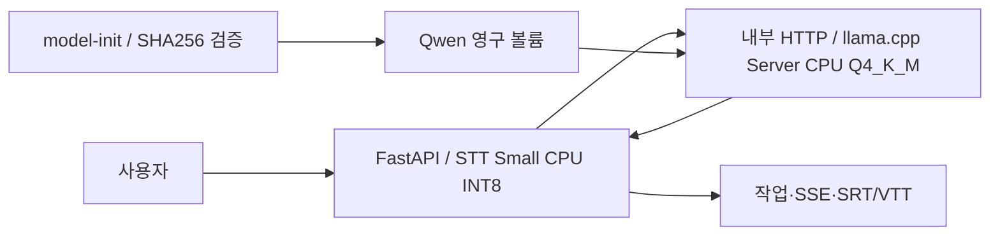

# CPU 전용 Docker 통합 검증 기록

2026-10-21 시작, 2026-10-22 갱신. **코드 통합·메모리 오류 수정 단계의 기록이다. Windows 실기기·장시간 파이프라인 전체 성공·호스트 7GB 목표는 완료되지 않았다.** 통합 단계는 로컬 커밋했으며 원격 push는 하지 않았다.

후속 기록: 이 통합 단계는 `fe23e1a`로 로컬 커밋했다. 이후 [짧은 캐시·CPU 속도 비교](cpu-speed-comparison-261022.md)에서 운영 기본 프롬프트 캐시를 활성화하는 변경을 추가했다. 아래 수치는 그 변경 이전의 기록이며 원격 push는 하지 않았다.

## 최종 실행 구성

기본 모델은 Qwen3-4B-Instruct-2507이며 Unsloth GGUF Q4_K_M을 사용한다. [고정 배포](https://huggingface.co/unsloth/Qwen3-4B-Instruct-2507-GGUF/tree/a06e946bb6b655725eafa393f4a9745d460374c9)의 공개 카드에서 base_model이 `Qwen/Qwen3-4B-Instruct-2507`, 라이선스가 Apache-2.0임을 확인했다. SHA256·크기·리비전은 `docker/qwen3-model.json`에 고정했고 실제 다운로드 검증을 통과했다.



backend는 모델을 직접 로드하지 않고 문맥·용어·존댓말·숫자·수식·재시도 로직을 유지한다. CPU 추론 잠금은 STT와 번역이 공유한다. translator는 device none·GPU layers 0·KV/연산 오프로딩 비활성화·컨텍스트 2048·슬롯 1·캐시 RAM 0이다. 후속 OOM 진단으로 CPU 가중치 재배치도 비활성화했다. 스레드·CPU 한도는 환경변수로 조절한다.

공식 CPU 이미지의 다중 아키텍처 인덱스를 digest로 고정했다. 기본 Compose는 플랫폼을 강제하지 않는다. Linux amd64와 arm64 각각의 CPU 바이너리를 사용하며 x86 전용 컴파일 옵션을 ARM에 전달하지 않는다.

`Dockerfile.cpu`의 backend는 MLX·mlx-lm·torch·llama-cpp-python을 설치하지 않는다. 실제 이미지에서도 패키지 미설치를 확인했다. CPU 서버 라이브러리·실행 옵션에서 GPU·Metal 비사용을 확인했다.

## 코드·의존성 정리

- `app/services/translation_llamacpp.py`와 MLX 로더 클래스·엔진 선택 분기를 제거했다. 공통 검증은 `translation.py`, Qwen 지시는 `translation_qwen.py`, HTTP 전송은 `translation_http.py`로 나눴다.
- `prepare_qwen.py`, `prepare_koreanlm.py`, `prepare_koreanlm_lora.py`, `prepare_koreanlm_gguf.py` 및 `requirements-mlx.txt`를 제거했다.
- MLX 평가 실행부·미사용 모델 다운로드 준비 함수를 제거했다. 과거 텍스트·체크섬·프롬프트 진단 도우미만 유지한다.
- 기본 설치 의존성을 CPU HTTP backend로 통합했고 CI도 torch 설치를 제거했다. Makefile의 MLX 준비·양자화·장치 선택 명령을 제거했다.
- 은퇴한 엔진·변환 테스트의 입력·기대값과 이전 모델 출처는 `evaluation/archive/`에 비실행 자료로 보존했다. 기존 평가 결과·강의 기준·모델 파일·Whisper 캐시는 삭제하지 않았다.
- README·DEVELOPMENT·Qwen 라이선스 고지·Docker 허용 목록·변경 테스트 선택기를 갱신했다. model-init은 라이선스·NOTICE도 모델 볼륨에 복사한다.

## 플랫폼·기능 검증

| 환경 | 실제 수행 | 판정 범위 |
| --- | --- | --- |
| Apple Silicon / Linux ARM64 Docker | 세 이미지 네이티브 빌드, Q4 로딩, 번역 API, 60초 음성·작업·SSE·SRT/VTT | 기본 기능 확인 |
| Linux amd64 / Mac의 x86 에뮬레이션 | 세 이미지 amd64 빌드, Q4 로딩, 3.68초 음성·작업·SSE·SRT/VTT | x86 이미지 기본 기능 확인 |
| macOS ARM64 네이티브 CPU | GPU 없이 빌드한 동일 llama.cpp 바이너리로 Q8/Q4 순차 비교 | 양자화 개발 비교 |
| Windows x86_64 / RAM 16GB 실기기 | 수행하지 못함 | **미검증** |

amd64 기본 시험은 Mac의 에뮬레이션이며 Windows·WSL2 실기기 검증이나 Windows 처리 속도가 아니다. Windows와 Mac의 공통 사용자 실행 명령은 `docker compose up -d --build`다.
amd64 실행 기록은 아래 후속 `--no-repack`·블록 FFT 변경 이전의 결과다. 두 변경 이후의 amd64 이미지는 다시 실행하지 않았으므로 최종 구성 전체를 amd64 검증 완료로 보지 않는다.

ARM64의 [60초 원본 음성 시험](cpu-split-arm64-smoke-261021.json)은 STT 11조각→4문장, 번역 반환 4/4, SSE status 6회, SRT/VTT HTTP 200과 다운로드 헤더를 확인했다. STT 전체 21.61초·번역 349.90초·작업 전체 371.53초였다. 약 4.11GB Docker VM에서 수행한 느린 예비 측정이며 병목 원인은 후속 분석 대상이다.

amd64의 [3.68초 원본 음성 시험](cpu-amd64-emulated-smoke-261022.json)은 1문장 번역·SSE·SRT/VTT 다운로드를 확인했다. STT 전체 16.29초·번역 44.60초·작업 전체 60.90초였다. 잘린 짧은 음성에서 `derived`를 `arrived`로 인식하고 번역에 불필요한 표현도 생겼다. **처리 경로 성공이 STT·번역 의미 정확도를 뜻하지 않는다.**

모델 캐시는 재시작 시 다운로드 없이 SHA256 검증 후 재사용했다. 실제 재실행을 확인했고 테스트 컨테이너는 종료하되 모델·Whisper·작업 결과 볼륨은 보존한다. API 오류·재시도·작업 실패·취소·진행률·숫자·수식·자막은 관련 회귀 테스트로 검사했다. 임의의 장시간 OOM·강제 장애 복구까지 실증한 것은 아니다.

## Q8_0 대 Q4_K_M

같은 Mac ARM64 CPU 서버 바이너리·소스 리비전·4스레드·컨텍스트 2048·슬롯 1·생성 설정으로 저장 STT 36구간과 별도 강의 2구간을 순차 평가했다. 수식 결합 전 36구간을 사용했다. 별도 강의는 [MIT 18.02 내적 강의](https://ocw.mit.edu/courses/18-02-multivariable-calculus-fall-2007/resources/lecture-1-dot-product/)의 짧은 공식 자막이며 [출처·수동 기준](holdout-linear-algebra-261021.json)을 보존한다. 새 음성 인식 평가나 통계적으로 대표성 있는 블라인드 시험은 아니다.

두 배포 파일의 템플릿 소스에는 사용하지 않는 assistant/reasoning 분기 차이가 있었다. 실제 system·user 역할의 43개 고유 프롬프트를 양쪽 템플릿으로 렌더링한 결과와 38개 첫 시도의 토큰 수는 모두 같았다. 앱 구현 SHA256과 첫 시도 메시지도 같았다. 네이티브 서버는 Docker 이미지와 같은 소스 리비전 `339f3242c761f16c27e5ffcde1d35dcc31933a55`에서 Metal·CUDA·Vulkan·OpenCL·Accelerate·BLAS를 끄고 빌드했다. [비교 빌드 근거](cpu-native-comparison-provenance-261021.json).

| 항목 | Q8_0 | Q4_K_M |
| --- | ---: | ---: |
| GGUF 파일 bytes | 4,280,403,520 | 2,497,281,120 |
| 저장 STT 번역 반환 | 36/36 | 33/36 |
| 별도 강의 번역 반환 | 2/2 | 2/2 |
| 총 시도 수 | 38 | 43 |
| 번역 합계 초 | 177.59 | 216.61 |
| 일반적 의미 정확도 | 미확정 | 미확정 |

원시 출력·메시지·토큰·검증 사유는 [Q8 결과](q8-server-native-261021.json), [Q4 결과](q4-server-native-261021.json)에 있다. Q4의 첫 보고서에서 holdout 추가 시 목록 참조 때문에 original_group_count가 38로 기록돼 36으로 메타데이터만 정정했고, 입력·출력은 바꾸지 않았다. 정정 이력도 보고서에 남겼다.

관측된 차이는 다음과 같다. 이는 독립된 전문가의 정량 채점이 아닌 출력 검토다.

- Q4는 stt-6·25·31에서 외국 문자·영어 연산어·용어 검증을 통과하지 못했다. 같은 입력에서 Q8은 번역을 반환했다.
- Q4는 `주습니다`, `멈추게 됩니다 합니다` 같은 잘못된 어미와 새 강의의 `좋아` 같은 반말을 냈다. 현 검사기가 모든 한국어 문법을 판별하지 못함을 확인했다.
- Q8도 `쉬습니다`라는 맞춤법 오류와 불완전한 수식 표현을 냈다. 38개 반환을 38개 의미 정답으로 해석하지 않는다.
- 두 모델 모두 원래 STT의 `2 vR prime of t`, 불명확한 함수·로그 범위 오류를 해결하지 못했다. 점곱과 내적의 동의어 차이는 오역으로 단정하지 않는다.

Q4 파일은 작아졌지만 이번 단일 시험에서 검증 실패가 늘고 총 시간도 길어졌다. **품질 저하가 허용 가능하다는 합격 판정은 유보한다.** 요청에 따라 Q4를 기본으로 유지하되, 속도·정확성 개선으로 홍보하지 않는다. 의미 40%·전공 보존 30%·자연스러움 15%·누락 10%·속도 5%의 종합 점수는 근거 없는 자동 채점을 하지 않았다.

## 메모리와 처리 시간의 한계

초기 한도는 backend 2.5GB + translator 4GB = 6.5GB다. 이는 호스트 Docker 메모리 7GB 달성 증명이 아니다.

- ARM64 60초 시험: 시작 이후 개별 cgroup peak는 backend 990,887,936 bytes·translator 3,792,146,432 bytes. 서로 다른 시점의 최대값이므로 더해 동시 사용량으로 보고하지 않는다. CLI 통계 샘플러가 시간 초과해 관측 누락이 있었다.
- amd64 짧은 시험: 개선한 Engine API 샘플러는 오류 없이 완료했다. 같은 표본의 두 컨테이너 working set 합계 관측 최대는 **3,458,273,280 bytes**였다. 개별 cgroup peak는 backend 1,090,097,152 bytes·translator 3,860,205,568 bytes였다. OOM 카운터·OOMKilled·재시작 증가는 없었다.
- Mac Docker 관련 데스크톱 프로세스 RSS 표본도 별도로 기록했으나 VM·커널 메모리와 전체 peak를 포함하지 않는다. 호스트 전체 메모리로 사용하지 않는다.
- 새 측정 도구는 표본 실패를 기록하면서 계속 수집하고, 같은 시점의 합계만 계산한다. 부분 번역·빈 결과·자막 누락·OOM·재시작을 성공으로 처리하지 않는다. 호스트 목표는 측정 여부와 무관하게 임의 합격 처리하지 않는다.

**남은 필수 실측:** 아래 후속 시험의 최종 구성 재검증, 장시간 파이프라인 전체 성공·처리 시간, Windows 16GB의 Docker Desktop/WSL2·호스트 전체 메모리. 현재 7GB 목표는 미검증이다. Windows 측정 없이 RAM 최적화 완료라고 표시하지 않는다.

## 10월 22일 후속 메모리 진단

[실제 입력·명령·체크섬·OOM 이벤트](cpu-long-media-provenance-261022.json)를 보존했다. MIT 공식 다운로드의 내적 강의에서 60초 위치부터 영상·음성을 복사해 실제 5분·30분 파일을 만들었다. 반복·합성 입력이 아니며 두 구간은 서로 겹친다. 5분 원본과 30분 원본도 로컬 임시 경로에 보존한다.

| 입력·구성 | 실제 결과 | 처리 시간 | 판정 |
| --- | --- | ---: | --- |
| 5분·CPU 재배치 기본 | translator OOM 8회·31/31 번역 실패 | 87.38초 | 실패 |
| 같은 5분·`--no-repack` | OOM·재시작 0·27/31 번역 반환·SSE/SRT/VTT 제공 | 836.73초 | 메모리 안정성 개선, 파이프라인 전체 성공은 아님 |
| 30분·`--no-repack`·기존 FFT | STT 중 backend OOM·SSE 연결 종료·작업 복구 후 interrupted 실패 | 접수 약 7초 후 종료 | 실패 |
| 같은 30분·`--no-repack`·블록 FFT | STT 398구간·190문장, OOM·재시작 0. 초기 번역 중 시험 취소 | STT 280.29초 | STT 메모리 검증만 완료, 전체 번역·자막 미검증 |

5분 [기존 구성](cpu-arm64-5min-261022.json)과 [재배치 비활성화 비교](cpu-arm64-5min-no-repack-261022.json)를 덮어쓰지 않았다. 후자는 STT 43.36초·번역 792.76초, 같은 측정 회차의 두 컨테이너 working set 합계 관측 최대 3,489,697,792 bytes, 컨테이너 표본 누락 없음이다. 수식 기호·다른 출력 검증 실패가 남았으므로 27개 반환을 의미 정답으로 세지 않는다.

기본 CPU 재배치의 translator 익명 메모리는 시험 전 표본에서 2,866,479,104 bytes였다. 재배치를 끄면 376,614,912 bytes로 줄고 가중치 대부분이 회수 가능한 파일 매핑으로 바뀌었다. 전체 모델 bytes가 그만큼 사라지는 것은 아니다. 4.11GB VM의 파일 재접근·메모리 압박은 여전히 관측돼 속도 개선을 보장하지 않는다. 기본 Compose에 `--no-repack`을 반영했지만 Windows 실기기와 변경 후 amd64 성능은 미검증이다.

30분 [첫 실패](cpu-arm64-30min-no-repack-261022.json)는 기존 특징 추출기가 긴 입력 전체의 STFT·FFT 임시 배열을 만드는 동안 발생했다. `app/services/stt_features.py`는 최대 3000프레임씩 계산하고 마지막에 전체 음성 최대값으로 정규화한다. 음성을 잘라 별도 전사하거나 VAD·beam·문맥을 바꾸지 않는다. 최종 특징 배열·패딩 음성의 메모리는 여전히 길이에 비례한다. 무음·짧은 입력·블록 경계·음량 차이·65초 프레임 보존을 원래 faster-whisper 추출기와 비교했고 `rtol=1e-5`, `atol=1e-6` 안에서 일치했다. 이는 모든 입력의 STT 문장이 완전히 같다는 증명이 아니다.

30분 [블록 FFT 재시험](cpu-arm64-30min-bounded-fft-261022.json)은 STT 전체 280.29초·추론 277.76초로 끝났으며 FFT 계산은 0.31초였다. VAD 이후 특징 음성은 1503.34초, 입력 음성은 1800.01초였다. backend 개별 cgroup peak는 1,669,894,144 bytes, translator는 2,797,785,088 bytes이며 서로 다른 peak를 합산하지 않는다. 같은 회차의 컨테이너 working set 합계 관측 최대는 3,256,434,688 bytes, 표본 오류는 없었고 두 컨테이너 OOM 카운터·재시작 증가는 0이었다. 사용자의 장시간 소요 피드백에 따라 이 메모리 검증 단계를 마치고 취소했다. 작업 상태는 cancelled·완료 카운터 2/190이며 전체 번역·SRT/VTT는 검증하지 않았다. 시험 컨테이너는 종료하고 캐시·기존 결과·원본 입력은 보존했다.

호스트 측정은 `lsof`로 Docker.raw를 연 VM을 식별하고 Docker VM·Desktop 프로세스의 현재 물리 footprint를 수집한다. 5분 번역 중 한 표본의 관측 합계는 4,889,167,896 bytes였으나 전체 시험 peak가 아니다. 30분 재시험의 관측 합계 최대는 4,917,284,112 bytes였으며 특권 helper PID 831의 footprint가 빠져 불완전 측정으로 표시했다. 누락 PID를 null·오류로 남기며 RSS나 컨테이너 합계와 혼동하지 않는다. 커널 귀속·공유 메모리·표본 사이 peak·Windows 미검증 한계 때문에 7GB 목표는 자동 합격하지 않는다.

SSE가 중단될 때도 측정 도구가 job_id·관측 이벤트·단계 로그를 보존하도록 고쳤다. 번역 결과 수가 완료 구간 수와 다르거나 표본 회차에 컨테이너가 빠진 경우도 성공·완전 측정으로 처리하지 않는다.


## 관련 검사 결과

후속 메모리 수정에서는 변경한 STT·측정·선택 도구와 관련된 7개 모듈의 56개 검사를 통과했다. 최종 동작을 담은 ARM64 이미지 내부 STT 특징·힌트 검사 5개도 통과했다. 뒤이은 Python 편집은 예외·부수 효과 docstring 추가뿐이며 실행 로직은 바꾸지 않았다. 이 단계에서도 전체 테스트 탐색은 실행하지 않았다.

변경 범위에 연결된 20개 테스트 모듈의 175개 검사를 통과했다. API 계약·HTTP/SSE 전송·재시도·STT 입력·작업·취소·자막·수식·다운로드·CPU 배포 설정·측정 도구·보존된 평가 진단을 포함한다. 전체 저장소 테스트 탐색은 실행하지 않았다. 최종 ARM64 이미지 내부의 HTTP·수식 결합·STT 테스트 20개도 통과했다. 변경 Python 코드의 모듈·클래스·함수 한국어 docstring과 매개변수·반환 필드를 검사했고 `git diff --check`도 통과했다.

## 재개 지점

1. Windows 16GB 실기기에서 공통 Compose로 설치·모델 준비·번역·STT·자막을 검증한다.
2. 메모리 수정 후 최종 구성의 1·5분 전체 경로와 30분 전체 번역·자막을 재검증한다. 이번 30분 STT 검증을 전체 파이프라인 성공으로 해석하지 않는다. OOM·샘플 누락·재시작을 별도 실패로 기록한다.
3. 느린 ARM Docker 처리의 메모리 압박·CPU 설정·서버 커널 영향을 비교한다. 기존 4.11GB VM 측정은 Windows 성능을 대표하지 않는다.
4. Q4 추가 실패·문법·수식 문제의 품질 수용 여부를 검토한다. 이번 리팩터링에서 프롬프트·검증을 특정 평가 문장에 맞춰 완화하지 않았다.
5. 최종 보고 후 커밋 범위·전체 메시지를 제시하고 명시적 승인을 받는다. 승인 전 커밋·push는 하지 않는다.

## 변경 파일 목록

작업 트리 기준이다. D는 제거 또는 비실행 아카이브 이동, ??는 신규 파일이다. 모델 파일과 기존 평가 결과는 보존한다.

```text
 M .dockerignore
 M .github/workflows/backend-ci.yml
 M DEVELOPMENT.md
 M Dockerfile.cpu
 M Makefile
 M README.md
 M app/main.py
 M app/services/translation.py
 D app/services/translation_llamacpp.py
 M app/services/translation_qwen.py
 D compose.cpu.yaml
 D data/qwen3_mlx.json
 D docker/koreanlm-model.json
 M docker/qwen3-model.json
 M requirements-api.txt
 M requirements-ci.txt
 M requirements-cpu.txt
 D requirements-mlx.txt
 M requirements.txt
 M scripts/benchmark_cpu.py
 M scripts/download_cpu_model.py
 M scripts/evaluate_api_translation.py
 M scripts/evaluate_candidates.py
 M scripts/evaluate_lecture_quality.py
 M scripts/evaluate_prompt_matrix.py
 M scripts/evaluate_qwen_lecture.py
 M scripts/evaluate_translation.py
 D scripts/prepare_koreanlm.py
 D scripts/prepare_koreanlm_gguf.py
 D scripts/prepare_koreanlm_lora.py
 D scripts/prepare_qwen.py
 M scripts/run_changed_tests.py
 M tests/test_capabilities.py
 D tests/test_cpu_runtime.py
 D tests/test_gguf_conversion.py
 D tests/test_llamacpp_translation.py
 D tests/test_lora_conversion.py
 M tests/test_model_download.py
 M tests/test_pipeline.py
 M tests/test_qwen_lecture.py
 M tests/test_qwen_translation.py
 M tests/test_translation_validation.py
 M third_party/qwen3/NOTICE.md
 M transcribe.py
?? Dockerfile.translator
?? app/services/stt_features.py
?? app/services/translation_http.py
?? compose.yaml
?? evaluation/archive/README.md
?? evaluation/archive/koreanlm-model.json
?? evaluation/archive/qwen3-mlx-source.json
?? evaluation/archive/retired-tests/test_cpu_runtime.py.txt
?? evaluation/archive/retired-tests/test_gguf_conversion.py.txt
?? evaluation/archive/retired-tests/test_llamacpp_translation.py.txt
?? evaluation/archive/retired-tests/test_lora_conversion.py.txt
?? evaluation/archive/training-requirements.txt
?? evaluation/cpu-amd64-emulated-smoke-261022.json
?? evaluation/cpu-arm64-30min-bounded-fft-261022.json
?? evaluation/cpu-arm64-30min-no-repack-261022.json
?? evaluation/cpu-arm64-5min-261022.json
?? evaluation/cpu-arm64-5min-no-repack-261022.json
?? evaluation/cpu-long-media-provenance-261022.json
?? evaluation/cpu-native-comparison-provenance-261021.json
?? evaluation/cpu-refactor-progress-261021.md
?? evaluation/cpu-split-arm64-smoke-261021.json
?? evaluation/cpu-unification-261021.md
?? evaluation/holdout-linear-algebra-261021.json
?? evaluation/q4-server-native-261021.json
?? evaluation/q8-server-native-261021.json
?? evaluation/qwen3-q8-model.json
?? scripts/macos_docker_memory.py
?? tests/test_cpu_benchmark.py
?? tests/test_cpu_configuration.py
?? tests/test_http_translation.py
?? tests/test_macos_docker_memory.py
?? tests/test_stt_features.py
```
